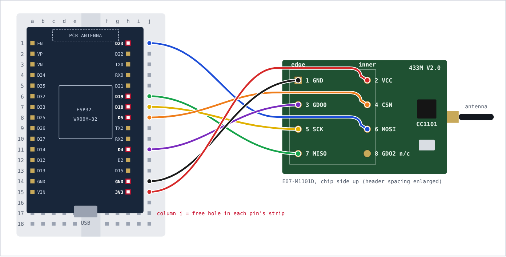

# Zephyr hood RF bridge for Home Assistant

Local control of a **Zephyr Lux Glo Island range hood (DLG-E36AWX)** from Home Assistant, with no cloud: an ESP32 and a CC1101 radio send the same 315 MHz codes as the hood's remote and decode the remote when someone uses it.

**Protocol:** [docs/PROTOCOL.md](docs/PROTOCOL.md), also as a typeset [PDF](docs/zephyr-rf-protocol.pdf).

| Button | Code |
|---|---|
| Light | `0x051430` |
| Fan | `0x051403` |
| Power off | `0x05140C` |
| Delay off | `0x0514C0` |

315 MHz OOK, 24-bit fixed code (16-bit address `0x0514` + 8-bit command), 270 µs unit, PT2262/EV1527 family. Your remote's address may differ; see [Using it with another hood](#using-it-with-another-hood).

## What you get in Home Assistant

| Entity | Type | What it does |
|---|---|---|
| Light, Fan, Power off, Delay off | Button | Sends one remote press |
| Light tap, Fan tap, Power off tap, Delay off tap | Switch | For HomeKit: turning on sends one press, then the switch flips back off after 1 s |
| Remote button | Event | Fires `light`, `fan`, `power` or `delay_off` when the physical remote is used |
| Last remote code | Sensor (diagnostic) | Last code heard from any remote |

The hood steps its light and fan levels internally (off → low → medium → high → off), and the radio link is one way, so nothing here tracks state. It behaves like a second remote.

## Hardware

| Part | Notes |
|---|---|
| ESP32 DevKit V1 (WROOM-32) | Any ESP32 works; update the pins if yours differ |
| Ebyte E07-M1101D (CC1101) with SMA antenna | Sold as 433 MHz; worked at 315 MHz from under the hood. A 315 MHz module and antenna improves range |
| 7 female-to-male jumpers, breadboard | The module's 2x4 header can't plug into a breadboard |

| CC1101 pin | Signal | ESP32 |
|---|---|---|
| 1 | GND | GND (next to 3V3) |
| 2 | VCC | **3V3** (not VIN) |
| 3 | GDO0 | D4, shared TX and RX |
| 4 | CSN | D5 |
| 5 | SCK | D18 |
| 6 | MOSI | D23 |
| 7 | MISO | D19 |
| 8 | GDO2 | not used |

On the E07-M1101D the square pad is pin 1, odd pins are on the board-edge row and even pins on the inner row.

## Install

1. In ESPHome Device Builder, create a device and paste [`zephyr-hood.yaml`](zephyr-hood.yaml).
2. Add `zephyr_api_key`, `wifi_ssid` and `wifi_password` to your ESPHome secrets (or paste the key Builder generated).
3. Flash over USB the first time, then adopt the device in Home Assistant.
4. For Apple Home, expose the four `switch.*_tap` entities through HomeKit Bridge and leave the buttons out.

Tested with ESPHome 2026.10.0.

> [!IMPORTANT]
> On the ESP32 the shared GDO0 pin must be **open drain with a pull-up**, as in the YAML. The `cc1101` `gdo0_pin` "automatic mode switching" setup receives fine but sends nothing the hood accepts.

## Using it with another hood

Remotes are paired to their hood, so another remote probably has a different address. To find yours:

1. Flash the YAML as is and press each button on your remote near the antenna.
2. Read the codes from the **Last remote code** sensor.
3. Put them in the `substitutions` block and re-flash.

If nothing shows up, your remote may use another band. [`tools/rtl433-band-scan.sh`](tools/rtl433-band-scan.sh) uses an RTL-SDR on a Mac to find it.

## Repository

| Path | Contents |
|---|---|
| `zephyr-hood.yaml` | ESPHome configuration |
| `docs/PROTOCOL.md` | Protocol reference |
| `docs/zephyr-rf-protocol.pdf` | Same, typeset |
| `docs/src/` | PDF source (built with the Sterling renderer via `tools/build_pdf.py`) |
| `captures/` | Raw timings of four Light presses |
| `tools/zephyr_rf.py` | Reference encoder and decoder (Python, no dependencies) |
| `tools/gen_figures.py` | Regenerates the SVG figures |
| `tests/` | Decoder tests against the real captures; run `python3 -m pytest tests` |

> [!WARNING]
> The codes are fixed and unauthenticated. Anyone in radio range who knows them can operate the hood.
