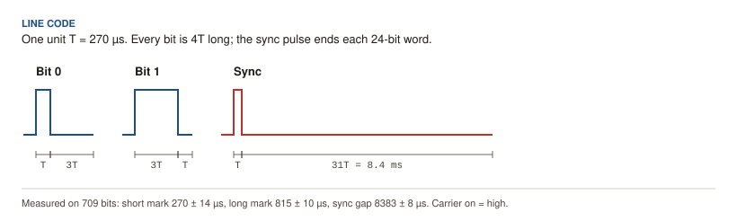
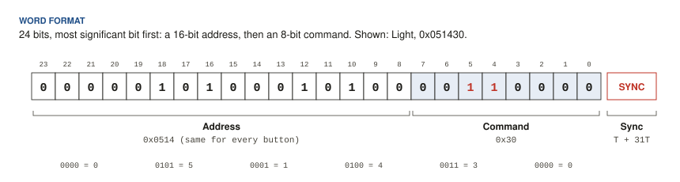
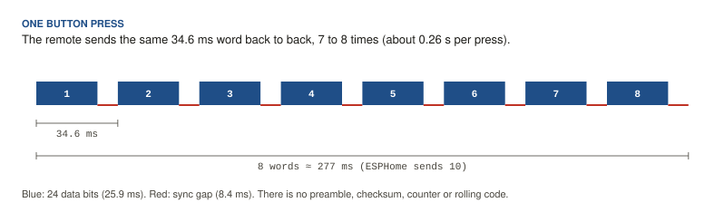

# Zephyr hood remote: RF protocol

**Device:** Zephyr Lux Glo Island hood, model DLG-E36AWX, with its round stainless-steel 4-button remote (FCC grantee code VVP, Leyant Industry Co., Zephyr's OEM).
**Captured:** 27 October 2026 with an ESP32 and an Ebyte E07-M1101D (CC1101) running ESPHome 2026.10.0.
**PDF edition:** [zephyr-rf-protocol.pdf](zephyr-rf-protocol.pdf)

> [!WARNING]
> This is a fixed-code protocol with no rolling code or authentication. Anyone within radio range who knows a code can operate the hood. Treat the codes in this document like a garage-door code.

## Summary

| Property | Value |
|---|---|
| Carrier | **315 MHz**, OOK (on-off keying) |
| Encoding | Pulse-width, PT2262 / EV1527 family ("RCSwitch protocol 1" timing ratios) |
| Unit time *T* | **270 µs** (measured 269.6 µs) |
| Word | 24 data bits, MSB first, followed by one sync pulse |
| Word length | 128 *T* = 34.6 ms |
| Repeats per press | 7 to 8 words, back to back (about 0.26 s) |
| Structure | 16-bit address `0x0514` + 8-bit command |
| Integrity | None: no preamble, checksum, counter or rolling code |
| Direction | One way. The hood never transmits. |

## Codes

| Button | Code | Command byte | Hood behaviour |
|---|---|---|---|
| Light | `0x051430` | `0011 0000` | Steps light: off → low → medium → high → off |
| Fan | `0x051403` | `0000 0011` | Steps fan: off → low → medium → high → off |
| Power | `0x05140C` | `0000 1100` | Turns fan and light off |
| Delay off | `0x0514C0` | `1100 0000` | Starts the delay-off timer (fan must be running) |
| Fan + Delay off together | `0x0514C3` *(inferred, untested)* | `1100 0011` | Wi-Fi/Bluetooth pairing mode, per Zephyr's Connect guide |

Every press of a button sends the same code. The light and fan levels step inside the hood, so the remote carries no state, and a level cannot be set directly; it takes *n* presses from a known level.

## Physical layer

The remote is a 23A 12 V battery transmitter. The hood listens on 315 MHz only; the 433.92 MHz FCC filing for Zephyr part 14000010 (FCC ID VVP-14000010) does **not** describe this remote, and nothing from the remote was heard at 433.92 MHz.

Received at 1 m with a CC1101 set to 315.000 MHz, ASK/OOK, 812 kHz receive bandwidth. The channel is otherwise silent at 315 MHz in this house. (Two unrelated 433.92 MHz sensors transmit every 30 s and 50 s; they use 425 µs / 2150 µs pulses and are not part of this protocol.)

## Line code

| Symbol | Carrier on | Carrier off | Total | Measured on / off (mean ± sd, µs) |
|---|---|---|---|---|
| Bit 0 | 1 *T* | 3 *T* | 4 *T* | 270 ± 14 / 806 ± 17 |
| Bit 1 | 3 *T* | 1 *T* | 4 *T* | 815 ± 10 / 265 ± 10 |
| Sync | 1 *T* | 31 *T* | 32 *T* | 271 ± 12 / 8383 ± 8 |

Measured over 709 bits and 27 sync pulses from four Light presses ([`captures/light_x4_2026-10-27.json`](../captures/light_x4_2026-10-27.json)). The sync gap is 31.1 *T*, which fixes *T* at 269.6 µs.

**Decoder tolerances** used in this repo: short = 120 to 480 µs, long = 560 to 1100 µs, sync gap ≥ 5 ms. These accept ±20% timing error (tested).

## Word format

Bits are sent most significant first. A word is the 24 data bits followed by the sync pulse; when words repeat, each sync gap separates one word from the next.

### Reading it as PT2262 tri-state

The layout matches the classic PT2262 encoder, where each tri-state digit is sent as a pair of bits: `00` = 0, `11` = 1, `01` = floating (F).

| Field | Bits | Tri-state digits |
|---|---|---|
| Address `0x0514` | `00 00 01 01 00 01 01 00` | `0 0 F F 0 F F 0` |
| Light `0x30` | `00 11 00 00` | `0 1 0 0` |
| Power `0x0C` | `00 00 11 00` | `0 0 1 0` |
| Fan `0x03` | `00 00 00 11` | `0 0 0 1` |
| Delay off `0xC0` | `11 00 00 00` | `1 0 0 0` |

Each button sets exactly one data digit. Eight tri-state address digits allow 3⁸ = 6,561 addresses. Zephyr pairs a remote to its hood with a sync procedure, so the hood stores the address it accepts. If two buttons pressed together combine their digits, as on PT2262 remotes, Fan + Delay off is `0x0514C3`; this has not been captured.

## Timing of one press

The remote repeats the word while it is held, 7 to 8 times for a normal tap. The receiver in the hood needs only one clean word. The ESPHome transmitter in this repo sends 10, which the hood accepts as a single press.

## State and feedback

There is no status request and no reply: the hood has a receiver and no transmitter on this band. The only places state exists are:

- inside the hood, and
- Zephyr's cloud, for hoods connected to the Zephyr Connect app over Wi-Fi (AWS IoT device shadow, TLS with a per-device certificate; no documented local API).

This repo therefore treats the ESP32 as a second remote and does not track state.

## Transmitting it with a CC1101 on an ESP32

| Setting | Value |
|---|---|
| Frequency | 315 MHz |
| Modulation | ASK/OOK |
| RX filter bandwidth | 812 kHz (worked; can likely be narrowed) |
| Output power | +10 dBm |
| Wiring | One data pin: CC1101 GDO0 to ESP32 GPIO4 |
| Pin mode | **Open drain with pull-up**, shared by `remote_transmitter` and `remote_receiver` |

> [!IMPORTANT]
> On an ESP32, use the open-drain single-pin method from the ESPHome CC1101 docs. Setting `gdo0_pin` on the `cc1101` component and sharing the pin (the "automatic mode switching" method) received correctly but transmitted no data the hood would accept. Switching to open drain fixed it immediately.

The 433 MHz-tuned E07-M1101D worked at 315 MHz from directly under the hood. A 315 MHz module and antenna is the upgrade if range from the final mounting spot is marginal.

## How it was found

1. **Wrong lead first.** The open-source [HomeSpan ZephyrVentHood](https://github.com/HomeSpan/ZephyrVentHood) project documents an older, non-Connect Zephyr Lux remote: 433.92 MHz, 20-bit code, 230/620 µs pulses. Nothing matched at 433.92 MHz.
2. **Two 433 MHz decoys.** A raw-capture build picked up regular 425/2150 µs bursts that turned out to be neighbouring sensors on a 30 s and 50 s schedule, not the remote.
3. **Frequency sweep.** An ESPHome build exposed the CC1101's frequency, modulation and bandwidth as Home Assistant selects, and an edge counter on GDO2 was read from Home Assistant history while the remote was pressed. At 315 MHz, four presses produced four isolated bursts on a silent channel.
4. **Decode.** Raw captures were published to a Home Assistant text sensor in 200-character chunks, reassembled, and decoded to the fixed codes above.

## References

- ESPHome CC1101 component: <https://esphome.io/components/cc1101/>
- HomeSpan ZephyrVentHood (older 433 MHz Zephyr remote): <https://github.com/HomeSpan/ZephyrVentHood>
- Zephyr Connect quick start (pairing with Fan + Delay off on DLG models): <https://zephyronline.com/wp-content/uploads/2025/11/Zephyr-Connect-Quick-Start-20250601.pdf>
- FCC ID VVP-14000010 (433.92 MHz Zephyr remote, a different model): <https://fcc.report/FCC-ID/VVP-14000010/>
